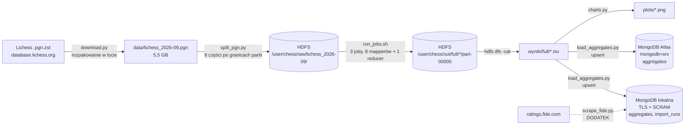

# Jak działa ten projekt – po ludzku

Ściąga do obrony. Najpierw obraz całości, potem każdy plik, potem szczegóły (HDFS, MapReduce, upserty, TLS), na końcu pytania, które może zadać prowadząca.

## 1. W jednym akapicie

Bierzemy 5,5 GB partii szachowych z Lichess (plik tekstowy PGN, 2,36 mln partii), wkładamy je do HDFS, czyli rozproszonego systemu plików Hadoopa. Trzy joby Hadoop Streaming (mapper i reducer w Pythonie) liczą z nich statystyki: czy pod presją czasu robi się więcej błędów, jak często wygrywa ktoś, kto przegrywał, i czy dłuższy namysł daje lepszy ruch. Wynik to 126 krótkich wierszy. Wgrywamy je do dwóch baz MongoDB: lokalnej (w Dockerze, z TLS i hasłem) i chmurowej (Atlas). Z tych samych wyników rysujemy trzy wykresy. Obok, jako dodatek, scraper pobiera ranking FIDE ze strony internetowej do lokalnej bazy.

## 2. Schemat przepływu danych



To samo w ASCII (gdyby mermaid się nie wyświetlał):

```
Lichess (.zst) --download.py--> data/lichess_2026-09.pgn (5,5 GB)
      --split_pgn.py--> HDFS /user/chess/raw/lichess_2026-09/part-000..007.pgn
      --run_jobs.sh (Hadoop Streaming: mapper.py x8 -> sortowanie -> reducer.py)-->
      HDFS /user/chess/out/full/{blunder_in_trouble,comeback_by_tc,think_vs_cpl}/part-00000
      --hdfs dfs -cat--> wyniki/full/*.tsv
           |--load_aggregates.py--> MongoDB lokalna (aggregates)  + import_runs
           |--load_aggregates.py--> MongoDB Atlas   (aggregates)
           `--charts.py-----------> plots/blunder.png, comeback.png, namysl.png

dodatek: ratings.fide.com --scrape_fide.py--> MongoDB lokalna (fide_top)
```

Wszystko to robi jedno polecenie: `./run_all.sh` (pełne dane) albo `./run_all.sh --probka` (50 MB, 2 minuty).

## 3. Co robi każdy plik

### Główny katalog

| Plik | Po co jest |
|---|---|
| `run_all.sh` | Cały przepływ po kolei: testy, sprawdzenie TLS, dane, HDFS, Hadoop, wyniki, import dwa razy, scraping, wykresy, podsumowanie baz. Log zapisuje w `wyniki/logi/`. |
| `docker-compose.yml` | Dwa kontenery: `partie-mongo` (MongoDB 7 z `--auth` i `--tlsMode requireTLS`) i `partie-hadoop` (jednowęzłowy Hadoop 3.4.3). Porty tylko na `127.0.0.1`. |
| `docker/hadoop.env` | Konfiguracja Hadoopa jako zmienne (obraz zamienia je na pliki XML): adres HDFS, replikacja 1, YARN z 10 GB pamięci i 10 rdzeniami na zadania. |
| `docker/hadoop-start.sh` | Start kontenera: formatuje NameNode przy pierwszym uruchomieniu, startuje NameNode, DataNode, ResourceManager, NodeManager, czeka na wyjście z safemode. |
| `.env.example` | Wzór pliku `.env` z hasłami i adresami baz. Prawdziwy `.env` nie jest w gicie. |
| `requirements.txt` | Pakiety Pythona z przypiętymi wersjami. |

### `src/` – kod Pythona

| Plik | Co robi |
|---|---|
| `pgn.py` | Parser PGN. `iter_games` dzieli strumień linii na partie (nowa partia = linia `[Event "`). `parse_movetext` wyciąga półruchy i komentarze `[%clk]` (zegar) oraz `[%eval]` (ocena silnika). Do tego czyszczenie nagłówków (`header_reject_reason`), klasa tempa i kubełki Elo. Tylko biblioteka standardowa, bo działa też w kontenerze Hadoop. |
| `analyses.py` | Trzy analizy, każda to funkcja „partia → rekordy”: `blunder_job`, `comeback_job`, `think_job`. Tu są wszystkie wzory (strata centypionów, próg błędu 100 cp, presja czasu ≤ 10 s, powrót −200 cp). |
| `streaming.py` | Klej między Hadoopem a analizami. `hadoop_lines` usuwa numer bajtu doklejany przez Hadoop, `map_games` woła analizę dla każdej partii i wypisuje `klucz<TAB>liczby`, `reduce_lines` sumuje liczby o tym samym kluczu. |
| `aggregate.py` | Sumowanie wyników bez Hadoopa (lokalnie) i czytanie plików TSV. Słownik `JOBS` (nazwa jobu → funkcja) używa też mapper. |
| `compare_sums.py` | Kontrola poprawności: liczy to samo lokalnym parserem i porównuje z wynikiem Hadoopa. `run_all.sh --probka` robi to automatycznie. |
| `download.py` | Pobiera archiwum `.zst` z Lichess strumieniowo, rozpakowuje w locie i przerywa po pierwszej pełnej partii za progiem 5,5 GB (cały miesiąc ma ok. 200 GB po rozpakowaniu). Gdy plik już jest, nic nie pobiera. |
| `split_pgn.py` | Dzieli 5,5 GB na 8 części po ok. 690 MB, zawsze przed linią `[Event "`, i wysyła je do jednego katalogu w HDFS. |
| `hdfs_io.py` | Polecenia `hdfs dfs` przez `docker compose exec`: wysłanie pliku albo części, sprawdzenie rozmiaru, pominięcie wysyłki, gdy w HDFS jest już to samo. Zapisuje metadane w `import_runs`. |
| `mongo_io.py` | Połączenia z bazami. Lokalna: `tls=True` i plik CA, Atlas: adres `mongodb+srv`. Odrzuca adres z `tlsAllowInvalidCertificates`. `record_import` zapisuje metadane importu. |
| `load_aggregates.py` | Czyta trzy pliki TSV, robi z nich dokumenty (`analysis`, `key`, nazwane liczby) i zapisuje upsertem do obu baz. |
| `verify_idempotent.py` | Dowód, że ponowny import nie powiela danych: liczy dokumenty, importuje dwa razy, liczy znowu. Z `--od-zera` najpierw czyści kolekcje. |
| `scrape_fide.py` | **Dodatek.** Pobiera ranking FIDE (12 list Top) z ratings.fide.com, parsuje HTML biblioteką BeautifulSoup, zapisuje upsertem do lokalnej bazy (`fide_top`). |
| `charts.py` | Trzy wykresy matplotlib z plików TSV. Małe próby (< 1000 ruchów) są kreskowane albo mają puste kółko. |
| `summary.py` | Wypisuje liczby dokumentów w obu bazach i metadane importów (bez haseł). |

### `mr/` – Hadoop Streaming

| Plik | Co robi |
|---|---|
| `mapper.py` | Jeden mapper dla trzech jobów; nazwę analizy dostaje w argumencie (`python3 mapper.py comeback_by_tc`). Czyta stdin, wypisuje na stdout. |
| `reducer.py` | Wspólny reducer: sumuje liczby w kolejnych liniach o tym samym kluczu. |
| `run_jobs.sh` | Uruchamia trzy joby `hadoop jar hadoop-streaming.jar ...` jeden po drugim, mierzy czas każdego i zapisuje go w `czasy.tsv`. |

### Pozostałe

- `scripts/gen_certs.sh` – tworzy własne CA i certyfikat serwera Mongo (openssl).
- `scripts/check_mongo_tls.py` – łączy się z lokalną bazą po TLS z plikiem CA i sprawdza, kto jest zalogowany.
- `tests/` – testy pytest na małych plikach PGN (parser, analizy, mapper i reducer, podział pliku, wykresy, loader).
- `wyniki/` – wyniki jobów z pełnego przebiegu (TSV), czasy i logi (dowody).
- `sprawozdanie_latex/`, `prezentacja/` – sprawozdanie i slajdy; `generuj.py` robi tabele i rysunki prosto z `wyniki/`.

## 4. HDFS w skrócie

HDFS to system plików Hadoopa. Plik jest dzielony na **bloki** (u nas domyślnie 128 MB), a bloki leżą na **DataNode'ach**. **NameNode** pamięta tylko, który blok jest gdzie (metadane). W prawdziwym klastrze bloki mają po 3 kopie na różnych maszynach; u nas jest jeden węzeł, więc `dfs.replication=1`.

U nas: `hdfs dfs -ls -h /user/chess/raw/lichess_2026-09` pokazuje 8 plików po ok. 656 MiB (razem 5,1 GiB = 5,5 GB). Dane fizycznie leżą w wolumenie Dockera `hadoop-data`, więc przeżywają restart kontenera i komputera.

Dlaczego HDFS, a nie zwykły dysk: wymaganie na 5,0, ale też logika Hadoopa – mapper dostaje kawałek danych z HDFS i liczy go tam, gdzie dane leżą („przenosimy obliczenia do danych, a nie dane do obliczeń”).

## 5. MapReduce na przykładzie `comeback_by_tc`

Pytanie: w jakim odsetku rozstrzygniętych partii zwycięzca w którymś momencie przegrywał o co najmniej 2 piony?

**Wejście.** Hadoop czyta plik linia po linii (`TextInputFormat`) i podaje mapperowi linie w postaci `numer_bajtu<TAB>treść`:

```
0	[Event "Rated Bullet game"]
28	[Result "1-0"]
...
612	1. e4 { [%eval 0.17] [%clk 0:01:00] } 1... c5 { [%eval -2.30] [%clk 0:01:00] } ...
```

**Map.** `mapper.py` usuwa numer bajtu (`hadoop_lines`), skleja linie w partie (`iter_games`) i dla każdej partii woła `comeback_job`. Ta funkcja: odrzuca remisy i partie bez ocen, sprawdza, czy zwycięzca miał kiedyś ocenę ≤ −2 piony (i czy trwało to 6 ocen z rzędu), i zwraca jeden rekord. Mapper wypisuje go jako tekst:

```
bullet	1,1,0      <- partia bullet, powrót tak, powrót utrzymany nie
blitz	1,0,0
bullet	1,1,1
```

**Shuffle i sort.** To robi sam Hadoop: zbiera wyjście wszystkich 8 mapperów, sortuje po kluczu (tekst przed tabulatorem) i wysyła do reducera tak, że wszystkie linie jednego klucza idą jedna po drugiej:

```
blitz	1,0,0
blitz	1,1,0
...
bullet	1,1,0
bullet	1,1,1
```

**Reduce.** `reducer.py` czyta linie po kolei i sumuje liczby, dopóki klucz się nie zmieni. Gdy przychodzi nowy klucz, wypisuje sumę poprzedniego. Dzięki sortowaniu nie musi trzymać w pamięci wszystkich kluczy naraz.

```
blitz	104385,49312,...
bullet	49770,27708,...
```

**Wynik** trafia do HDFS jako `/user/chess/out/full/comeback_by_tc/part-00000` (5 wierszy, jeden na tempo). Odsetek (`comeback / n`) liczymy dopiero przy wykresie, bo odsetków nie da się sumować, a liczby – tak.

Dodatkowo mapper wysyła **liczniki** Hadoopa (`reporter:counter:chess,games,...` na stderr): ile partii przeczytał, ile odrzucił i dlaczego. Widać je w logu jobu (np. `games=2362417`).

### Dlaczego 8 części i 8 mapperów

Hadoop sam dzieli plik na **splity** (zwykle = blok 128 MB) i każdy split dostaje jeden mapper. Problem: partia PGN to kilkanaście linii, a granica bloku nie wie, gdzie kończy się partia. Hadoop dba tylko o to, żeby nie przeciąć *linii*. Partia przecięta w połowie trafiłaby w kawałkach do dwóch mapperów: pierwszy policzyłby ją bez końcówki, a drugi pominąłby jej ogon.

Pierwsza wersja projektu ustawiała `split.minsize` na 2 TB, więc cały plik był jednym splitem i jednym mapperem – poprawnie, ale bez równoległości (ok. 10 min na job). Teraz `split_pgn.py` dzieli plik na 8 części, zawsze tuż przed `[Event "`, a `split.minsize` dalej jest ogromne, więc **każda część to dokładnie jeden split i jeden mapper**. 8 mapperów liczy naraz. Pomiar na tych samych danych: jeden mapper 31 min 43 s, osiem mapperów 5 min 24 s (ok. 5,9 razy szybciej), wyniki identyczne bajt w bajt.

## 6. Idempotentny import (upserty)

„Idempotentny” = uruchomiony drugi raz daje ten sam stan, nic się nie dubluje.

- **HDFS:** pliki wysyłamy z nadpisaniem (`hdfs dfs -put -f`). Gdy w HDFS są już części o tych samych rozmiarach, wysyłka jest pomijana.
- **MongoDB:** każdy dokument agregatu ma klucz `(analysis, key)`, np. `("comeback_by_tc", "blitz")`. Na tej parze jest **unikalny indeks**. Zapis to `update_one(filtr, {"$set": dokument}, upsert=True)`: jeśli dokument o tym kluczu istnieje, jest nadpisywany, jeśli nie – wstawiany. Drugi import nie może dodać drugiego „blitza”, a gdyby ktoś próbował zwykłym `insert`, indeks unikalny by to odrzucił.
- **Metadane:** `import_runs` ma jeden dokument na rodzaj importu (`pipeline`), też upsertem.
- **FIDE:** to samo, klucz `(list, period, rank)`.

Dowód: `verify_idempotent.py` – liczba dokumentów przed, po pierwszym i po drugim imporcie: 0 → 126 → 126 w obu bazach (przy `--od-zera`).

## 7. TLS i uwierzytelnienie w MongoDB

Dwie różne rzeczy:

- **Szyfrowanie (TLS)** – nikt po drodze nie podejrzy danych ani hasła. Serwer Mongo ma certyfikat podpisany naszym własnym CA (`scripts/gen_certs.sh`). Serwer działa z `--tlsMode requireTLS`, więc połączenie bez TLS jest zrywane. Klient (`mongo_io.local_client`) łączy się z `tls=True` i plikiem `certs/ca.pem` – **sprawdza**, czy certyfikat serwera podpisało nasze CA i czy nazwa się zgadza (SAN: `localhost`, `127.0.0.1`). Nie wyłączamy tej weryfikacji: adres z `tlsAllowInvalidCertificates` jest odrzucany w kodzie.
- **Uwierzytelnienie (SCRAM)** – kto się łączy. Serwer ma `--auth`, użytkownik `admin` z hasłem z `.env`. SCRAM-SHA-256 to wymiana wyzwanie–odpowiedź: hasło nie leci otwartym tekstem.
- `--tlsAllowConnectionsWithoutCertificates` znaczy tylko, że **klient** nie musi mieć własnego certyfikatu. Nie wyłącza TLS ani sprawdzania certyfikatu serwera.
- **Atlas:** adres `mongodb+srv://` ma TLS włączony domyślnie, a użytkownik i hasło są w adresie (w `.env`). Atlas ma też listę dozwolonych adresów IP.

Próby z dowodów: bez TLS – połączenie zerwane; TLS bez naszego CA – `certificate verify failed`; TLS + CA bez hasła – `requires authentication`; komplet – działa.

## 8. Trzy analizy i wykresy

Dane do analiz to **adnotacje w samym pliku**: `[%clk 0:00:08]` (ile zostało na zegarze) i `[%eval -2.30]` (ocena silnika Lichess w pionach, z perspektywy białych). Ocenę ma tylko część partii (ok. 10% w naszym wycinku), bo Lichess analizuje silnikiem tylko niektóre. Własnego silnika nie uruchamiamy.

1. **Błędy pod presją czasu (`blunder_in_trouble`, `plots/blunder.png`).** Błąd = ruch, po którym ocena gracza spadła o ≥ 100 centypionów (1 pion). „Pod flagą” = na zegarze ≤ 10 s. Wykres: odsetek błędów pod flagą (czerwony) i z czasem (zielony), osobno dla tempa i rankingu. Wniosek: pod flagą błędów jest wyraźnie więcej we wszystkich dużych grupach, np. blitz 1200–1599: 18,7% → 29,4%.
2. **Powroty (`comeback_by_tc`, `plots/comeback.png`).** Udział rozstrzygniętych partii, w których zwycięzca był kiedyś gorszy o ≥ 2 piony. Dwa warianty: wystarczy jedna taka ocena albo 6 ocen z rzędu (ostrzejszy, bo jedna zła ocena bywa chwilowym wahaniem w środku wymiany). Im szybsze tempo, tym więcej powrotów. Zastrzeżenie: to nie jest „szansa wygrania z gorszej pozycji”, bo mianownik to wszystkie partie z oceną.
3. **Czas namysłu a strata (`think_vs_cpl`, `plots/namysl.png`).** Czas ruchu = poprzedni zegar gracza − obecny + inkrement. Średnia strata centypionów w koszykach 0–2 s, 2–10 s, 10+ s. W blitzu i bullecie dłuższy namysł idzie w parze z **większą** stratą – to nie znaczy, że myślenie szkodzi: dłużej myśli się w trudnych pozycjach, w których łatwiej o błąd (korelacja, nie przyczyna).

Kreskowane słupki / puste kółka = mniej niż 1000 ruchów, z takich komórek nie wyciągamy wniosków (np. classical pod flagą).

## 9. Scraping FIDE (dodatek)

Ustalone z prowadzącą: to moduł poboczny, nie część głównego przepływu. `scrape_fide.py` pobiera stronę główną ratings.fide.com, z linków bierze kody list (`list=...`), dla każdej listy pobiera tabelę HTML (z przerwą 1 s między żądaniami) i parsuje wiersze BeautifulSoupem: miejsce, nazwisko, federacja, ranking, rok urodzenia. Zapis upsertem do lokalnej kolekcji `fide_top` (1202 dokumenty). Nie łączymy tych nazwisk z nickami z Lichess – to inne osoby.

## 10. Pytania, które może zadać prowadząca

1. **Skąd dane i ile ich jest?** Lichess Open Database, wrzesień 2026, licencja CC0. Bierzemy początek miesiąca: 5 500 001 981 B nieskompresowanego PGN, 2 362 417 partii, 47,3 mln linii. Plik w HDFS: katalog z 8 częściami, 5,1 GiB.
2. **Po co HDFS, skoro to jeden komputer?** Wymaganie projektu, ale też zasada działania Hadoopa: dane leżą w blokach na DataNode'ach, a mappery czytają je lokalnie. Na jednym węźle nie ma replikacji (`dfs.replication=1`), ale kod i polecenia są takie same jak w klastrze.
3. **Co robi mapper, a co reducer?** Mapper: z każdej partii robi rekord `klucz<TAB>liczby` (np. `blitz<TAB>1,1,0`). Hadoop sortuje po kluczu. Reducer sumuje liczby o tym samym kluczu. Odsetki liczymy dopiero po jobie.
4. **Dlaczego reducer może sumować „po kolei”?** Bo Hadoop przed reducerem sortuje wyjście mapperów po kluczu – wszystkie linie jednego klucza przychodzą razem. Wystarczy pamiętać bieżący klucz i jego sumę.
5. **Ile było mapperów i dlaczego?** 8, bo wejście to 8 plików, a `split.minsize` = 2 TB sprawia, że Hadoop nie tnie pliku na bloki 128 MB. Cięcie bloków przecinałoby partie. Wcześniej był 1 plik = 1 mapper (31 min 43 s), teraz 8 mapperów (5 min 24 s).
6. **Po co `hadoop_lines` / regex `^\d+\t`?** Przy wejściu tekstowym Streaming podaje mapperowi linie z numerem bajtu i tabulatorem na początku. Usuwamy go, żeby dostać czysty PGN.
7. **Jak działa idempotentny import?** Unikalny indeks na `(analysis, key)` i `update_one(..., upsert=True)`: istniejący dokument jest nadpisywany, nowy wstawiany. Dowód: 0 → 126 → 126 w obu bazach.
8. **Co jest w której bazie?** Lokalna: `aggregates` (126), `import_runs` (metadane: SHA-256 pliku, ścieżki HDFS, liczby dokumentów, czas) i `fide_top` (dodatek, 1202). Atlas: `aggregates` (126). Surowe partie są tylko w HDFS – 5,5 GB nie zmieściłoby się w darmowym Atlasie (512 MB) i nie ma takiej potrzeby.
9. **Czym różni się TLS od uwierzytelnienia?** TLS szyfruje połączenie i potwierdza, że serwer jest tym, za kogo się podaje (certyfikat podpisany naszym CA). Uwierzytelnienie (SCRAM, login i hasło) potwierdza, kim jest klient.
10. **Co to `tlsAllowConnectionsWithoutCertificates`?** Serwer nie wymaga certyfikatu od klienta. TLS dalej jest obowiązkowy, a klient dalej sprawdza certyfikat serwera.
11. **Jak sprawdziłeś, że Hadoop liczy poprawnie?** `compare_sums.py`: te same trzy analizy policzone zwykłym Pythonem na próbce 50 MB dają identyczne sumy jak joby Hadoop. Do tego testy jednostkowe na ręcznie przygotowanych partiach.
12. **Czy wyniki są reprezentatywne?** Nie w pełni: to początek jednego miesiąca i tylko partie z oceną silnika (ok. 10%), czyli nielosowa część. Wyniki są opisowe i korelacyjne.
13. **Dlaczego definicja powrotu ma dwa warianty?** Pierwsza (jedna ocena ≤ −2 piony) łapie też chwilowe wahania, np. w środku wymiany figur. Ostrzejsza wymaga 6 ocen z rzędu (3 pełne ruchy). Oba warianty pokazują ten sam kierunek: im szybsze tempo, tym więcej powrotów.
14. **Dlaczego dłuższy namysł = większa strata?** To korelacja. Gracz myśli dłużej, gdy pozycja jest trudna, a w trudnej pozycji łatwiej o błąd. Nie wynika z tego, że myślenie szkodzi.
15. **Co się stanie, jak uruchomisz `run_all.sh` drugi raz?** Plik nie jest pobierany ponownie, części nie są dzielone ani wysyłane drugi raz (te same rozmiary), joby liczą od nowa i nadpisują katalogi wyników w HDFS, a import do Mongo nadpisuje te same 126 dokumentów. Liczby dokumentów się nie zmieniają.

Dodatkowe, krótko:

- **Gdzie jest web scraping?** Dodatek: ranking FIDE → lokalne Mongo (`fide_top`), upsert po `(list, period, rank)`.
- **Czemu nie Spark?** Wymaganie mówi o Hadoop MapReduce / Streaming, a Python przez Streaming jest dopuszczony wprost.
- **Co z sekretami?** Hasła tylko w `.env` (poza gitem), kod nigdy ich nie wypisuje; porty baz i Hadoopa wystawione tylko na `127.0.0.1`.
